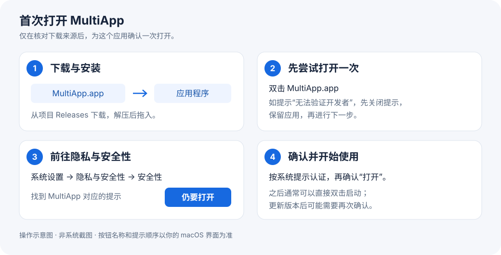

# MultiApp

**一个桌面，多个独立身份。** 原生 macOS 应用多开管理器，目前支持飞书。

本仓库只提供安装包、使用说明、更新记录和问题反馈，**不提供应用源码**。源码与开发历史由作者私有维护。

[下载安装包](https://github.com/sunholdshen/multi-app/releases) · [首次打开图文指南](docs/first-launch.md) · [应用内更新](docs/updates.md) · [链接打开方式](docs/links.md) · [使用与维护](docs/usage.md) · [更新记录](CHANGELOG.md) · [反馈问题](https://github.com/sunholdshen/multi-app/issues)

**beta.6 新增链接打开方式：** 在 MultiApp 中启用后，浏览器点击「在飞书中打开」可以每次选择原版或副本，也可设置默认飞书。粘贴链接入口允许临时选择其他实例，已有副本无需重建。

## 安装

1. 在 Releases 中下载对应芯片的 ZIP：M 系列选择 `arm64`，Intel 选择 `x86_64`。
2. 解压，将 `MultiApp.app` 拖入「应用程序」。需要 macOS 13 或更高版本。
3. 双击打开 MultiApp。若提示无法验证开发者，按下方图文指南完成首次打开。
4. 选择本机已安装的官方飞书，点击「新建副本」，完成后在副本中登录另一个账号。

普通使用无需 Python、Homebrew、Xcode 或管理员权限。发布包仅包含管理器，不含飞书客户端、聊天记录或账号数据。

Releases 自动生成的 **Source code (zip/tar.gz)** 仅包含本仓库的说明文档，不包含 MultiApp 程序源码；请下载以 `MultiApp-` 开头的安装包。

### 首次打开提示“无法验证开发者”？

先尝试打开 MultiApp，再进入 ** → 系统设置 → 隐私与安全性 → 安全性 → 仍要打开**，按系统提示认证并确认打开。

**[查看完整图文操作指南 →](docs/first-launch.md)**（含 Apple 官方界面示例、“仍要打开”按钮位置及常见问题）

本指南适用于未验证／未公证提示。如果系统明确提示“已损坏”或检测到恶意软件，请先查看指南中的对应处理方式。无需关闭系统安全保护。

## 升级已有安装

beta.4 及更早版本需要手动下载一次新版并替换 `MultiApp.app`。从 **beta.5** 起，可在「关于 MultiApp → 检查更新…」中下载安装，默认每天检查；也可开启「自动下载并在退出时安装」。已有飞书副本和账号数据保留，详见 [软件更新说明](docs/updates.md)。

## 功能

- 创建多个副本，自定义名称与颜色，分别登录与同时运行。
- **图标数字角标**：保留原应用图标，在右下角内侧附加 1–99 的自定义序号，支持改色、预览和关闭。
- **应用内更新**：检查新版、下载安装并重启管理器，支持自动检查及可选的退出时安装。
- 启动副本、查看运行状态、打开独立数据目录。
- 使用新版原飞书重建副本，保留副本数据。
- 移除时只把受管应用移到废纸篓，保留登录和聊天数据。
- 原版与识别到的外部副本支持启动与查看。

新建副本时可直接设置序号；已有副本请退出后，在卡片菜单选择 **「… → 图标与序号…」**。旧版副本不会自动改图标，关闭序号可恢复原图标。beta.4 已修复程序坞额外底板，beta.3 用户保持原序号重新应用一次即可。详见 [图标与序号说明](docs/usage.md#图标与序号)。

## 兼容性与验证

已在 Apple M5、macOS 26.6.2、飞书 8.5.3（构建 147.0.7727.149）上验证创建、启动到登录页、保留数据重建和移除。重建及移除后的 221 个测试数据文件逐一比对保持一致。0.1.0-beta.3 增加数字角标；核心测试覆盖旧配置兼容、图标恢复、签名验证与保存失败回滚。

- Intel 安装包已交叉编译，尚未在 Intel Mac 实机验证。
- 目前仅支持飞书；微信、Lark 国际版和其他应用尚未适配。
- 尚未全面验证登录后的通知、会议、浏览器 SSO 和企业设备信任流程。
- 当前预览版采用本地临时签名，尚未经过 Apple 公证。首次打开请按 macOS「系统设置 → 隐私与安全性」提供的流程操作。MultiApp 不会关闭 Gatekeeper 或 SIP。
- 副本使用独立数据目录，但不等同于操作系统安全沙盒。副本自身自动更新被禁用，请通过管理器重建升级；原版自动更新不受影响。

## 许可与来源

从 0.1.0-beta.2 起，MultiApp 以闭源方式维护和发行，官方安装包可免费下载和运行，详见 [使用许可](LICENSE)。此前已公开的 0.1.0-beta.1 及其历史代码所授予的 MIT 许可不被追溯撤回，见 [历史许可](licenses/MIT-0.1.0-beta.1.txt)。

方法来源与第三方说明见 [THIRD_PARTY_NOTICES.md](THIRD_PARTY_NOTICES.md)。MultiApp 与飞书及其权利人无隶属关系。
