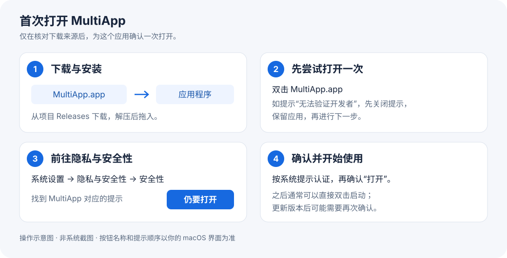

# macOS 首次安装与信任操作图文指南

[← 返回下载主页](../README.md) · [下载安装包](https://github.com/sunholdshen/multi-app/releases) · [使用与维护](usage.md)

MultiApp 当前是**尚未经过 Apple 公证的预览版**。首次打开时，macOS 可能显示“无法验证开发者”或“Apple 无法检查是不是包含恶意软件”。确认安装包来自本项目 Releases、并决定使用后，可以按下面的单个应用放行流程操作。

本文适用于 MultiApp 支持的 macOS 13 及以上版本。示例截图来自 Apple 官方支持，展示的是 macOS Sequoia；macOS 版本、系统语言不同，提示文案可能略有差别。**截图中的“示例 App”对应你实际看到的“MultiApp”。**

## 1. 下载并移入“应用程序”

打开 [MultiApp Releases](https://github.com/sunholdshen/multi-app/releases)，展开所需版本的 **Assets**，下载对应的 ZIP：

| 你的 Mac | 安装包文件名结尾 |
| --- | --- |
| Apple 芯片（M1、M2、M3、M4、M5 等） | `-arm64.zip` |
| Intel 芯片 | `-x86_64.zip` |

不知道芯片类型时，点击屏幕左上角 ** → 关于本机** 查看“芯片”或“处理器”。Intel 包尚未在 Intel Mac 实机验证。

双击 ZIP 解压，把 **MultiApp.app** 拖入访达的 **“应用程序”** 文件夹，再从那里双击打开。

> 下载以 `MultiApp-` 开头的 ZIP。旁边的 `.sha256` 是校验文件；GitHub 自动生成的 `Source code` 归档仅包含说明文档，都不是安装包。

## 2. 先打开一次，遇到拦截时保留应用

如果显示下面这类**未验证／未公证**提醒，点击“完成”“好”或“取消”等关闭提示的按钮（以实际界面为准），保留 MultiApp，然后进入第 3 步。

  

*图 1：未公证 App 的系统提醒示例。[图片及说明来源：Apple 支持](https://support.apple.com/zh-cn/102445)。*

如果 MultiApp 已正常打开，可以跳过后面的信任步骤。如果系统只询问“这是从互联网下载的 App，确定要打开吗？”，核对应用与来源后按提示选择“打开”即可。

## 3. 在“隐私与安全性”里点“仍要打开”

1. 点击屏幕左上角 ** → 系统设置**。
2. 在左侧选择 **隐私与安全性**（英文为 **Privacy & Security**）。
3. 在右侧向下滚动，找到 **安全性** 区域。
4. 找到与 **MultiApp** 对应的拦截说明，点击右侧 **仍要打开**（英文为 **Open Anyway**）。请核对应用名称，避免为其他软件放行。

  

*图 2：Apple 官方截图已标出“仍要打开”按钮。[图片及说明来源：Apple 支持](https://support.apple.com/zh-cn/102445)。*

## 4. 完成系统认证，再确认“打开”

如果 macOS 要求认证，请按提示使用 Touch ID 或输入**这台 Mac 的登录密码**；系统可能要求管理员授权。这是系统授权步骤，不是飞书账号、Apple 账户或 GitHub 密码；不要把密码发到聊天或 issue 中。

如果再次显示警告，核对名称为 MultiApp 后，按系统提示点击 **打开** 或 **仍要打开**。系统认证与最终确认的先后顺序可能因版本而异。

看到 MultiApp 的“应用副本”主界面，即完成首次打开。之后通常可以直接双击启动；更新后的应用版本可能需要再次确认。接下来按 [使用与维护](usage.md) 创建飞书副本。

## 常见情况

| 遇到的情况 | 处理方式 |
| --- | --- |
| 没有“仍要打开”按钮 | 回到“应用程序”再尝试打开 MultiApp 一次，然后重新进入“隐私与安全性”并向下滚动。如果应用已能打开，就不需要此按钮。 |
| 按钮不可用，或提示由组织管理 | 公司／学校设备可能限制应用安装，请联系管理员处理。 |
| 提示“已损坏，无法打开” | 不要直接当作普通的未公证提示。先从本项目 Releases 重新下载；仍有问题时附上版本号和完整错误文案提交 issue。 |
| 提示“将损坏你的电脑”、发现恶意软件，或已被系统移至废纸篓 | 停止打开，不按本指南继续放行，并反馈完整提示。 |
| 更新后重新出现验证提醒 | 核对新版安装包来源；若仍是未验证／未公证提醒，可重新按本流程操作。 |

本流程只为所选应用建立打开例外。**不需要关闭 Gatekeeper 或 SIP，也不需要改为允许“任何来源”、修改钥匙串证书信任，或运行终端命令清除隔离标记。**

## 参考与图片说明

- [Apple 官方：在 Mac 上安全地打开 App](https://support.apple.com/zh-cn/102445)。步骤根据该文档核对，核对日期：2026-11-09。
- 图 1、图 2 为 Apple 官方示例图，使用原始链接展示，版权归 Apple 所有；未将示例图改成 MultiApp 实机截图。
- 顶部流程图为本项目绘制的操作示意图。此指南不代表 MultiApp 已获得 Apple 公证或安全认证。

若图片未加载，可直接按上述文字步骤操作，或打开 Apple 官方页面查看原图。
