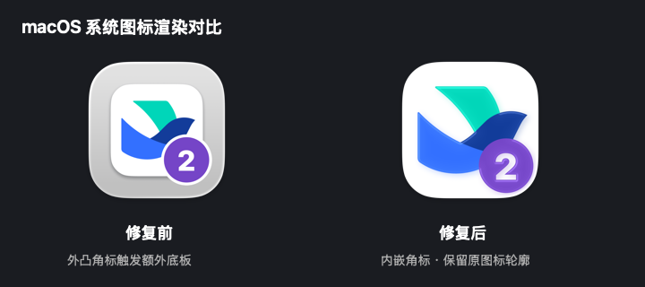

# 使用与维护

首次安装时若遇到“无法验证开发者”等提示，请先查看 [macOS 首次打开与信任操作图文指南](first-launch.md)。

## 新建

1. 选择本机的官方飞书客户端。
2. 点击「新建副本」，填写名称并选择标记颜色。
3. 等待复制、隔离、签名和校验完成。
4. 点击「打开副本」，在副本中用第二个或其他账号登录。

每个副本通常占用约 2 GB 磁盘空间。实际大小和内存占用取决于客户端版本。管理器不会自动登录、收集密码或代替用户完成登录授权。

## 图标与序号

从 0.1.0-beta.3 起，新建副本会推荐尚未使用的序号（从 2 开始）。可输入 **1–99** 的自定义数字，选择标记颜色，或关闭「显示数字序号」。预览同时展示大图标与较小尺寸。

已有受管副本可点击右上角「… → 图标与序号…」。先退出这个副本，再点击「应用图标」；运行中可以预览，但不能保存。更新会临时复制应用、改图标、重新签名并验证，需要至少 4 GB 可用磁盘空间。账号文件和副本身份不变，失败时恢复旧应用与记录。重新签名后，客户端可能要求重新登录；保存前请确认可以完成登录验证。

从 0.1.0-beta.4 起，角标位于原图标右下角内侧，不再外凸或添加白色描边，避免 macOS 26 在程序坞额外添加灰白色底板。与右上角的未读提醒分开。关闭序号恢复保存的原图标；重建升级会沿用序号和颜色。旧版记录直接兼容，升级管理器不会自动改变现有副本图标。原版和外部副本保持原样。

**更新 beta.3 的旧图标**：退出对应副本，进入「图标与序号…」，保持原来的数字和颜色，点击「应用图标」即可。管理器会识别旧样式，不需要先改成其他数字。

如果 Dock 暂时显示旧图标，先退出并重新打开对应副本；固定在 Dock 的旧入口可从 Dock 移除，再从 MultiApp 打开并重新保留。无需重启整个 Dock。

## 原版与已有副本

原版只用作复制来源，可以继续运行。管理器会识别部分此前创建的飞书副本，提供启动和定位入口。外部副本没有 MultiApp 归属标记，不能从管理器重建或删除。

## 管理器更新

从 beta.5 起，可在「关于 MultiApp → 检查更新…」中下载、安装和重启管理器，支持自动检查和可选的退出时安装。详见 [软件更新说明](updates.md)。

## 飞书副本升级

先正常更新官方飞书，再退出需要升级的副本，在副本菜单中选择「保留数据并重建」。其他副本和原飞书可以保持运行。构建通过验证后才替换应用，数据目录不变；旧应用移到废纸篓。

如果原客户端在构建期间被自动更新，校验会失败。等原版完成更新后重试。

## 取消和恢复

取消会在当前复制、签名或校验阶段结束后生效，不会强制终止正在写入的组件。常规失败会清理临时构建并保留原有副本。若系统断电或管理器被强制结束，可能留下 `.building-*`、`.previous-*` 或尚未登记的应用；不要在不确认归属时删除它们。应用与数据目录分开保存，可以人工恢复。

## 移除

先退出副本，选择「移除副本」。应用移到废纸篓，数据始终保留。原应用、外部副本和其他副本不受影响。移除前可通过「查看独立数据目录」记录位置。

如果用户自行把受管应用移走，管理器会标记「文件缺失」。将应用放回原路径即可恢复；当前版本不会自动查找或删除失联应用的数据。

## 数据位置

| 内容 | 位置 |
| --- | --- |
| 副本应用 | `~/Applications/MultiApp/Feishu-FMxxxxxxx.app` |
| 副本数据 | `~/Library/Application Support/FMxxxxxxx/` |
| 管理器记录 | `~/Library/Application Support/MultiApp/instances.json` |
| 原飞书数据 | `~/Library/Application Support/LarkShell/`（管理器不改写） |

`FMxxxxxxx` 是每个副本独有的目录标识。副本的 `update` 子目录设有用户级不可变标记以阻止官方更新；数据清理需先对**对应副本**的 update 目录执行 `chflags nouchg`。管理器不提供一键永久删除账号数据功能。

## 诊断

操作记录只在本次运行期间保留。提交 issue 时请提供 macOS、芯片、飞书构建版本、管理器版本及错误阶段，不要上传账号数据目录或登录凭据。
